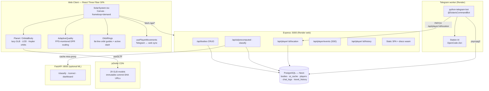
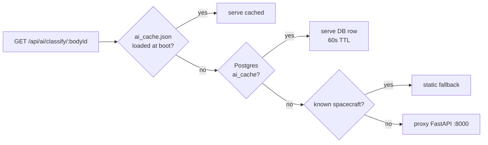

# Solar System · Cinematic 3D Tour

A full-screen 3D solar system with a cinematic camera tour through the Sun, 8
planets, and 20+ dwarf planets, asteroids, comets, interstellar objects, and
NASA spacecraft. Rendered with high-quality GLB models. Built with React Three
Fiber, Drei, and Three.js.

---

## Features

- **Cinematic tour** — 10s solar-system establishing shot (full 360° orbit), then camera visits each body with smooth easing (5s per body, loops continuously)
- **29 GLB models** — sun + 8 planets + moon + 7 dwarf planets/KBOs (Pluto,
   Ceres, Eris, Makemake, Haumea, Gonggong, Orcus) + 3 asteroids (Bennu,
   Itokawa, Eros) + 9 NASA spacecraft, loaded via `useGLTF` and auto-normalized
   to correct scale. 11 small bodies with no NASA model (Dragonfly + minor
   asteroids) render procedural textured spheres. Per-body loading grid shows
   individual progress; overlay dismisses when all models load or after a 15s
   timeout.
- **NASA spacecraft** — Curiosity Rover (Mars), Cassini (Saturn), Hubble Space
   Telescope (Earth), Voyager 1 (outer system), Apollo Lunar Module (Earth),
   JWST, New Horizons, Juno, Voyager 2, Dragonfly as first-class bodies with
   their own orbits, data panels, and mission info cards. Spacecraft models
   sourced from [NASA 3D Resources](https://github.com/nasa/NASA-3D-Resources)
   (public domain), available as native GLB files — no conversion needed;
   Dragonfly renders a procedural textured sphere (no NASA model exists).
- **Bloom + Stars** — emissive sun glow via `@react-three/postprocessing`,
  custom instanced star field. Bloom auto-disables when tour is paused to save
  GPU.
- **Pause / Free Look** — toggle pauses the tour and enables OrbitControls for
  manual exploration
- **Click-to-focus** — click any body to fly the camera to it; tour pauses
  until focus completes
- **Hover tooltip** — hover any body to see its name and type
- **Body detail modal** — click "Details" on the HUD card to open a full modal
  with physical/orbital/rotation data, AI classification, similar-body
  navigation, and (for spacecraft) a Mission Info card showing agency, launch
  year, target, and status
- **AI classification** — precomputed ML classifications served via Express
  (planet/dwarf planet/asteroid/comet/spacecraft/etc.) with confidence scores,
  feature importance, and similar-body navigation, displayed in the HUD and detail modal
- **Scale toggle** — 4 modes: Visual (1×), Hybrid (0.6×), Real Planet Size (0.35×), Real Distance (0.25×)
- **Textures** — real NASA textures embedded in the GLBs; dwarf planets without texture maps and minor asteroids use procedural Canvas noise textures as fallback
- **Saturn rings** — procedurally generated ring geometry on Saturn
- **HUD overlay** — current body name and a short fact, fades in on each
  transition
- **Orbit rings** — merged single-draw-call fat-line orbit guides
  (`LineSegments2`), with a bright animated dashed highlight on the tour/focus
  body's orbit
- **Adaptive quality** — `PerformanceMonitor` samples real FPS and scales the
  renderer DPR (1.75 → 1.0) on slow devices, recovering when frames improve
- **Cinematic grade** — ACES filmic tone mapping, god-ray sun glow, instanced
  nebula background, and a film-grain overlay for the "cinematic" look; bloom
  auto-disables while paused to save GPU
- **Real orbits** — planet positions from the `astronomy-engine` ephemeris
  (`lib/astronomy-positions.ts`) instead of hand-tuned Keplerian orbits
- **Cinematic grade** — god-ray sun glow, instanced nebula background, and a
  film-grain overlay for the "cinematic" look; bloom auto-disables while paused
  to save GPU
- **Custom bodies** — create your own worlds via the "+ Add" button (POST
  `/api/bodies`); they merge into the scene with earth-like default visuals
- **Telegram bot** — chat with SOLARIS Network station AIs on Telegram
  (@SolarisCommandBot): A.R.E.S. Flight Command (Earth), Dr. Vance (Lunar
  Gateway), Deep-Space Drone 09 (Kuiper Belt). Runs on OpenCode Zen with
  `npm run ai:bot`. **New**: `/travel` command syncs location between Telegram
  and web app; chat memory summarization preserves conversation context across
  sessions; travel history tracking records your journey
- **Body comparison tool** — interactive side-by-side comparison of up to 4
  celestial bodies with radar chart visualization, searchable catalog, and
  detailed data tables. Access via "Compare" button in any body detail modal
- **Real-time location sync** — Server-Sent Events (SSE) broadcast player
  movements between Telegram bot and web clients; travel history API tracks
  your exploration journey with source attribution (web/telegram)
- **Progressive Web App (PWA)** — installable on desktop and mobile with
  offline support. Service worker precaches static assets (~2 MB) and caches
  GLB models (30 days), Draco WASM (1 year), and API calls (NetworkFirst, 5
  min) for fast repeat visits. Chrome/Edge show install prompt; iOS/Android
  support "Add to Home Screen". Standalone app experience with custom splash
  screen and theme color.
- **Web Vitals tracking** — Core Web Vitals (CLS, LCP, INP, TTFB, FCP)
  monitored via `web-vitals` library and sent to Sentry. Poor ratings trigger
  warning events for performance monitoring. Rating thresholds follow web.dev
  standards.

---

## Architecture

See `AGENTS.md` for the full agent-oriented reference. Key modules:





```
client/src/components/solar-system/
  SolarSystem.tsx        — Canvas, lights, planets, spacecraft, tour, HUD
  Planet.tsx             — GLB loader + orbital/spin logic, click-to-focus, hover, Saturn rings
  OrbitalBody.tsx        — Positions moons/spacecraft relative to parent body each frame
  CinematicTour.tsx      — Camera animation state machine (damp3)
  OrbitRings.tsx         — Merged LineSegments (1 draw call) + astronomy-engine positions
  InstancedStars.tsx     — Custom Points-based star field
  FocusCamera.tsx        — Camera lerp driven by zustand focus store
  LoadingSpinner.tsx     — Per-body loading progress grid
  BodyDetailModal.tsx    — Full-body detail modal with data explorer + mission info + similar bodies
  BodyComparisonTool.tsx — Interactive comparison tool with radar chart + data tables
  CustomBodyModal.tsx    — "+ Add" form for user-created bodies
  BodySearch.tsx         — Search palette (press "/")
  EnhancedDataExplorer.tsx  — Collapsible data panels (physical/orbital/rotation/AI)
  AIClassificationPanel.tsx — ML classification display
  DebugPanel.tsx         — GLB load status overlay
  FilmGrainOverlay.tsx   — Cinematic film-grain post-pass
  NebulaBackground.tsx   — Instanced nebula dust
  SunGlow.tsx            — God-ray sun glow shader
  AtmosphereGlow.tsx     — Per-body atmospheric glow sprite
  RingSystem.tsx         — Procedural ring geometry (Saturn)
  ScaleControl.tsx       — Visual/Hybrid/Real-size/Real-distance scale modes
  PerformanceMonitor.tsx — DOM overlay FPS/draw-call monitor (reads stores/performance)
  PerformanceMetricsProbe.tsx — R3F-side probe writing WebGL metrics to stores/performance
  KeyboardShortcutsModal.tsx — Shortcut cheat-sheet ("?" key)
  bodies.ts              — Body config (name, radius, orbit, speed, tilt, fact, color, asset pointer,
                           parentBody, missionInfo)
```

### Body Types

| Type | Color | Description |
|------|-------|-------------|
| `star` | gold | The Sun |
| `planet` | blue | 8 solar system planets |
| `dwarfPlanet` | orange | Pluto, Ceres, Eris, etc. |
| `asteroid` | grey | Bennu, Eros, Psyche, etc. |
| `comet` | green | Halley's Comet |
| `interstellar` | purple | ʻOumuamua |
| `spacecraft` | teal | NASA missions (Curiosity, Cassini, Hubble, Voyager, Apollo LM) |

### Asset Pointers (`.glb.asset.json`)

Each `.glb.asset.json` file is a JSON object with a single `url` key pointing
to the **jsDelivr CDN** (immutable commit-SHA URL, CORS-enabled, correct
`model/gltf-binary` MIME):

```json
{ "url": "https://cdn.jsdelivr.net/gh/vodkashot-star/solar-system@<commit-sha>/client/public/models/curiosity.glb" }
```

Never hardcode `/models/` URLs — to switch hosts, update the `url` field only.
Publish a new model set: commit the GLBs, then bump the SHA in all 29 pointers
(script: iterate `client/src/assets/solar/*.glb.asset.json`,
`json.dump({"url": BASE + name})`). Draco WASM stays self-hosted (small files).

### NASA Model Conversion Pipeline

```bash
npm run models:convert -- "/path/to/NASAmodel.obj" output-name
```

Pipeline: `obj2gltf` → Draco compression + 1024px texture resize → validation.

### GLB Validation

```bash
npm run models:validate            # Validate all GLB models
npm run models:validate -- --fix   # Validate and auto-fix (add Draco compression)
npm run models:validate -- --json  # JSON output for CI
```

Pipeline validates: GLB binary header, asset JSON pointers, Draco compression, file size limits.

---

## Getting Started

```bash
npm install
npm run dev               # Vite dev server (:5000) + FastAPI (:8000)
npm test                  # vitest (185 tests)
npm run validate          # typecheck + tests
npm run build             # Production build → dist/
npm run build:cf          # CF Pages build (Draco → Vite)
npm run models:convert    # Convert a NASA OBJ model to GLB (see above)
npm run models:validate   # Validate GLB structure (headers, Draco, sizes)
npm run models:fetch      # Download NASA models
npm run ai:check          # Validate GLBs against the ML classifier
npm run ai:train          # Train classifier — add -- --tune for GridSearchCV tuning
npm run ai:train-regression  # Train mass + temperature regressors
npm run ai:retrain        # Retrain with corrections from DB
npm run ai:cv             # Cross-validate saved model
npm run ai:serve          # FastAPI :8000 (dev only)
npm run ai:test           # spaceAI pytest suite (50 tests)
npm run ai:bot            # Telegram station-AI bot (needs .env tokens)
npm run db:migrate        # Drizzle generate + push (Postgres migrations)
```

### Production Deployment (Render)

Live: **https://solar-system-api-ohxd.onrender.com**

`render.yaml` defines three free-tier services:

| Service | Type | Start command |
|---------|------|---------------|
| `solar-system-api` | web | `node dist/index-prod.js` (Express + static) |
| `solar-system-ml` | web | `run.py serve` (FastAPI :8000) |
| `solar-system-bot` | worker | `telegram_bot.py` (SOLARIS Network) |

Set `DATABASE_URL`, `TELEGRAM_BOT_TOKEN`, `OPENCODE_API_KEY`, `SENTRY_DSN` as
secret env vars in the Render dashboard (marked `sync: false` in the config).
`SPACEAI_URL` points at the ML service URL (Render services are separate
containers — `localhost` never reaches it). The bot uses `SOLARIS_API_URL`
(defaults to the Render URL) for `/travel` location sync. Static hosting (PWA
build only) lives on Surge: `npm run deploy:surge` →
**https://solar-system-3d.surge.sh**

### Remote Access (localhost.run tunnel)

Public URL: **https://c34246beaef275.lhr.life** (bound to account `jnx3316@gmail.com` — stable across reconnects).

```bash
ssh -N -i ~/.ssh/lhr -R 80:localhost:5000 localhost.run   # persistent (detached)
```

Restart after reboot: `setsid nohup ssh -N -i ~/.ssh/lhr -R 80:localhost:5000 localhost.run > /tmp/tunnel.log 2>&1 &`

---

## Telegram Bot (SOLARIS Network)

Chat with in-world station AIs on Telegram: **[@SolarisCommandBot](https://t.me/SolarisCommandBot)**.

- **Stations**: A.R.E.S. Flight Command (Earth), Dr. Vance (Lunar Gateway, Moon),
  Deep-Space Drone 09 (Kuiper Belt, Makemake) — each a distinct persona
- **Brain**: OpenCode Zen (`deepseek-v4-flash-free`) via the OpenAI-compatible
  API — replies keep under 3 sentences, rendered with Markdown fallback
- **Resilience**: rate-limit (429) replies "Relay Busy" flavor text; model
  failures reply "Signal lost"; Telegram API failures fall back to plain text

```bash
npm run ai:bot            # uses spaceAI/venv — plain python has no deps
```

Requires `TELEGRAM_BOT_TOKEN` + `OPENCODE_API_KEY` in `.env`
(see `.env.example`). Runs from `spaceAI/` (cwd) and loads the root `.env` via
python-dotenv. IPv4-first DNS resolution is patched in-process — this box has
no IPv6 route. Daemon mode: `setsid nohup npm run ai:bot > /tmp/aibot.log 2>&1 &`

Headless-mode + location-aware station routing (from `player_characters`) are
upcoming.

---

## Tech Stack

### Frontend
| Technology | Purpose |
|------------|---------|
| **React 18** + **TypeScript** | UI framework |
| **Three.js** / **@react-three/fiber** / **@react-three/drei** | 3D rendering (R3F) |
| **postprocessing** | Bloom, visual effects |
| **Chart.js** / **react-chartjs-2** | Radar charts for body comparison |
| **Zustand** | State management (`stores/` — camera-focus, cinematic-mode, performance, simulation) |
| **Tailwind CSS** | Styling (HUD) |
| **Vite** | Build tool / dev server |
| **vite-plugin-pwa** | PWA manifest + service worker (offline support) |

### Backend
| Technology | Purpose |
|------------|---------|
| **Express** | HTTP server (:5000) |
| **Drizzle ORM** | PostgreSQL migrations & queries |
| **tsx** | TypeScript execution (dev) |
| **esbuild** | Server bundling (production) |

### ML Sub-project (`spaceAI/`)
| Technology | Purpose |
|------------|---------|
| **Python 3.9+** (venv 3.14) / **FastAPI** | ML microservice (:8000) |
| **scikit-learn** | RandomForest classification, regression |
| **pandas** / **numpy** | Data processing |
| **joblib** | Model serialization |
| **uvicorn** | ASGI server |
| **python-telegram-bot** / **openai** | Telegram bot + OpenCode Zen client |

### Infrastructure & Tooling
| Technology | Purpose |
|------------|---------|
| **PostgreSQL** (Neon) | Primary database |
| **Render** | Production hosting — web + FastAPI + Telegram bot (https://solar-system-api-ohxd.onrender.com) |
| **jsDelivr** | Global CDN for the 29 GLB models (GitHub-backed, commit-SHA pinned) |
| **GitHub Actions** | CI/CD |
| **Surge** | Static hosting (https://solar-system-3d.surge.sh) |
| **Vitest** | Unit testing |

---

## API Endpoints

The project serves two API surfaces — **Express** (production, `:5000`) and **FastAPI** (ML training/dev, `:8000`). In production the Express server reads a precomputed AI cache; FastAPI is optional.

### Express API (`:5000`)

All routes prefixed with `/api`. Request cascade: Drizzle DB → `spaceAI/data/ai_cache.json` (loaded at startup) → static fallback (known spacecraft) → FastAPI proxy.

| Method | Endpoint | Description | Request | Response |
|--------|----------|-------------|---------|----------|
| `GET` | `/api/health` | Health check | — | `{ status, cached_bodies }` |
| `GET` | `/api/ai/precomputed` | All precomputed AI classifications (DB + static fallback, proxies to FastAPI on miss) | — | `Record<bodyId, { bodyId, classification, confidence, alternatives, features, similarObjects }>` |
| `GET` | `/api/ai/classify/:bodyId` | Classify a single body (DB → static → FastAPI proxy) | Query: `orbital_period`, `axial_tilt`, `mass`, `radius`, `eccentricity` required; `density`, `gravity`, `temperature`, `semi_major_axis`, `inclination`, `rotation_period` optional (default 0) | `{ classification, confidence, uncertainty, alternatives[], features[], similarObjects[] }` |
| `POST` | `/api/ai/correct` | Submit a classification correction | JSON: `{ body_id, predicted_type, corrected_type, features[], uncertainty }` | `{ status: "ok" }` |
| `POST` | `/api/classify/:bodyId/correct` | Direct correction path (mirrors FastAPI) | JSON: `{ predicted_type, corrected_type, features[], uncertainty }` | `{ status: "ok" }` |
| `GET` | `/api/bodies` | List all celestial bodies | — | `CelestialBody[]` (from Postgres) |
| `GET` | `/api/bodies/:id` | Get a single celestial body | — | `CelestialBody` or `404` |
| `POST` | `/api/bodies` | Create a celestial body | JSON: `{ name, type, ... }` | `201` → created body |
| `PATCH` | `/api/bodies/:id` | Update allowed fields | JSON with whitelisted fields (name, type, mass, radius, density, gravity, temperature, orbitalPeriod, semiMajorAxis, eccentricity, inclination, rotationPeriod, axialTilt, aiClassification, aiConfidenceScore) | Updated `CelestialBody` or `404` |
| `DELETE` | `/api/bodies/:id` | Delete a celestial body | — | `{ status: "ok", deleted: CelestialBody }` or `404` |
| `GET` | `/api/player/:telegramUserId` | Get player profile | — | Player object or `404` |
| `PATCH` | `/api/player/:telegramUserId/location` | Update player location (web or Telegram) | JSON: `{ bodyId }` or `{ bodyName, name }` | Updated player + `bodyName` |
| `GET` | `/api/player/:telegramUserId/history` | Get travel history | Query: `?limit=20` (max 100) | `[{ id, fromBodyId, toBodyId, fromBodyName, toBodyName, source, createdAt }]` |
| `GET` | `/api/player/events` | Real-time player movement stream (SSE) | — | Server-Sent Events stream with `{ type, userId, bodyId, bodyName, timestamp }` |

### FastAPI (`:8000` — ML Microservice)

Used during development and training. CORS enabled for all origins.

| Method | Endpoint | Description | Request | Response |
|--------|----------|-------------|---------|----------|
| `GET` | `/health` | Health check | — | `{ "status": "ok" }` |
| `GET` | `/precomputed` | All cached classifications | — | `Record<bodyId, AIAnalysis>` |
| `GET` | `/classify/{body_id}` | Classify with 11 features | Query: `orbital_period`, `axial_tilt`, `mass`, `radius`, `eccentricity` (required); `density`, `gravity`, `temperature`, `semi_major_axis`, `inclination`, `rotation_period` (optional, default 0) | `{ classification, confidence, uncertainty, alternatives[], features[], similarObjects[] }` |
| `POST` | `/classify/{body_id}/correct` | Store a user correction in SQLite | JSON: `{ body_id, predicted_type, corrected_type, features, uncertainty }` | `{ id, status: "recorded" }` |
| `GET` | `/corrections` | List recent corrections | Query: `?limit=50` | `Correction[]` |
| `POST` | `/predict/mass` | Predict mass from features | JSON: `{ "features": [11 floats] }` | `{ prediction: float, confidence_interval: [float, float] }` |
| `POST` | `/predict/temperature` | Predict temperature from features | JSON: `{ "features": [11 floats] }` | `{ prediction: float, confidence_interval: [float, float] }` |

### Data Flow

1. Frontend fetches `GET /api/ai/precomputed` once on mount
2. Express serves from DB cache or static fallback (known spacecraft); proxies to FastAPI if both are empty
3. Per-body fallback: `GET /api/ai/classify/:bodyId` with 11 feature query params
4. Corrections saved to Postgres + forwarded to FastAPI SQLite; `npm run ai:retrain` incorporates them
5. In production, FastAPI is optional — Express can load `spaceAI/data/ai_cache.json` at startup

### ML Feature Vector

The 11 features used for classification (see [`spaceAI/README.md`](spaceAI/README.md) for full training docs):

| # | Feature | Unit | Description |
|---|---------|------|-------------|
| 1 | `orbital_period` | days | Time for one full orbit |
| 2 | `axial_tilt` | degrees | Tilt of rotation axis |
| 3 | `mass` | Earth masses | Mass relative to Earth |
| 4 | `radius` | Earth radii | Radius relative to Earth |
| 5 | `eccentricity` | 0–1+ | Orbit shape (0 = circle, >1 = hyperbolic) |
| 6 | `density` | g/cm³ | Mean density |
| 7 | `gravity` | m/s² | Surface gravity |
| 8 | `temperature` | K | Surface/effective temperature |
| 9 | `semi_major_axis` | AU | Average distance from Sun |
| 10 | `inclination` | degrees | Orbital inclination |
| 11 | `rotation_period` | hours | Length of day (negative = retrograde) |

---

## Tour Controls

| Action | Key / UI |
|--------|----------|
| Pause tour | Click "Pause tour · Free look" (top-right) |
| Resume tour | Click "Resume tour" (top-right) |
| Focus body | Click any body in the scene |
| Prev / next body | `←` / `→` |
| Open search | `/` or click "Search" button |
| Scale toggle | Click "REALISTIC" / "CINEMATIC" (top-right) |
| Free look (paused) | Click + drag to rotate, scroll to zoom |
| Close modal / clear focus | `Esc` |

The tour starts with a 10s solar-system establishing shot (wide orbit at distance 80, full 360° rotation), then cycles through all bodies (celestial + spacecraft). Each body gets 5 seconds: ~1.5s fly-in, ~3s arc around (216°), ~0.5s pull-back.

> **Note:** The Canvas uses `frameloop="demand"` — every `useFrame`/animation
> callback must call `state.invalidate()` or the scene freezes. `Planet`,
> `OrbitalBody`, `CinematicTour`, and `FocusCamera` all do this. When paused
> (speed 0, no tour), glows/stars/orbital groups skip `invalidate()` so the
> scene truly freezes (`stores/simulation.ts`).
>
> See [`AGENTS.md`](AGENTS.md) for AI API endpoints, database schema, CI/CD,
> GLB asset references, spacecraft details, and known issues.

---

## Project Structure

```
solar-system/
├── client/                          # React + Vite frontend
│   ├── index.html                   # PWA meta tags, viewport-fit=cover, safe-area
│   ├── public/
│   │   ├── models/                  # 29 GLB files (sun, planets, asteroids, spacecraft)
│   │   ├── sounds/                  # Background music & SFX
│   │   ├── draco/                   # Draco WASM decoder (copied by copy-draco.sh)
│   │   ├── fonts/
│   │   ├── icons/                   # PWA icons (192/512 + maskable)
│   │   ├── CNAME
│   │   ├── privacy.html
│   │   └── terms.html
│   ├── src/
│   │   ├── main.tsx                 # Entry (Sentry init, PWA registration)
│   │   ├── App.tsx                  # Router, lazy SolarSystem, ModelPreview, web vitals
│   │   ├── index.css
│   │   ├── components/
│   │   │   ├── ModelPreview.tsx     # ?model= GLB studio preview
│   │   │   └── solar-system/        # R3F scene components (see Architecture above)
│   │   │       ├── SolarSystem.tsx  # Canvas + scene orchestrator
│   │   │       ├── Planet.tsx       # GLB loader + orbital/spin logic
│   │   │       ├── CinematicTour.tsx
│   │   │       ├── OrbitalBody.tsx  # Parent-relative moon/spacecraft positioning
│   │   │       ├── FocusCamera.tsx
│   │   │       ├── OrbitRings.tsx   # Fat-line orbit guides (LineSegments2)
│   │   │       ├── AdaptiveQuality.tsx  # FPS-monitored DPR scaling
│   │   │       ├── InstancedStars.tsx
│   │   │       ├── PerformanceMonitor.tsx        # DOM overlay (reads store)
│   │   │       ├── PerformanceMetricsProbe.tsx   # R3F probe (writes store)
│   │   │       ├── KeyboardShortcutsModal.tsx
│   │   │       └── bodies.ts        # Body configuration data
│   │   ├── assets/solar/            # .glb.asset.json CDN pointers (one per model)
│   │   ├── hooks/                   # useAIClassification, useCustomBodies,
│   │   │                            # useKeyboardNavigation, usePlayerMovements,
│   │   │                            # usePerformance (R3F-only)
│   │   ├── lib/                     # astronomy-positions, kepler, lod-manager,
│   │   │                            # custom-bodies, procedural-textures, glow-textures,
│   │   │                            # draco-setup, sentry, web-vitals, utils, config
│   │   ├── stores/                  # Zustand stores (camera-focus, cinematic-mode,
│   │   │                            # performance, simulation)
│   │   └── test/                    # Vitest unit tests (185)
│   │   └── vite-env.d.ts
├── server/                          # Express backend (:5000)
│   ├── app.ts                       # setup + PORT env (no reusePort)
│   ├── config.ts                    # env validation (DATABASE_URL required)
│   ├── db.ts                        # Drizzle + Postgres (Neon)
│   ├── routes.ts                    # AI API, bodies CRUD, player location
│   ├── logger.ts                    # pino
│   ├── sentry.ts                    # server-side Sentry
│   ├── index-dev.ts                 # Dev server (Vite middleware)
│   └── index-prod.ts                # Production server
├── shared/
│   └── schema.ts                    # Drizzle DB schema (6 tables, see AGENTS.md)
├── spaceAI/                         # Python ML service (:8000) + Telegram bot
│   ├── api.py                       # FastAPI app
│   ├── run.py                       # CLI entry point (serve port ← SPACEAI_PORT)
│   ├── telegram_bot.py              # Telegram station-AI bot (SOLARIS Network)
│   ├── validate_taxonomy.py         # Taxonomy schema validation
│   ├── venv/                        # Local venv — python deps live here (gitignored)
│   ├── src/
│   │   ├── predict.py               # CelestialPredictor (RF/SVC/Ensemble)
│   │   ├── train_model.py           # Model training
│   │   ├── train_regression.py      # Mass/temperature regression
│   │   ├── classify.py
│   │   ├── precompute.py            # Precompute AI classifications
│   │   ├── cache.py
│   │   ├── database.py
│   │   ├── augment_data.py
│   │   ├── recommend.py
│   │   └── config.py
│   ├── data/                        # Training data & AI cache
│   ├── models/                      # Trained .pkl models + archives/ (v1–v17)
│   ├── tests/                       # pytest suite (50 tests)
│   ├── docs/troubleshooting.md
│   ├── alembic/                     # Legacy SQLAlchemy migrations (superseded by Drizzle)
│   ├── Dockerfile
│   ├── requirements.txt
│   └── pyproject.toml
├── drizzle/                         # PostgreSQL migrations (Drizzle ORM)
│   ├── meta/
│   ├── 0000_youthful_maestro.sql
│   ├── 0001_rainy_nighthawk.sql
│   ├── 0002_sour_adam_warlock.sql
│   ├── 0003_plain_jean_grey.sql    # scene params → celestial_bodies
│   └── 0004_mushy_kylun.sql        # player_characters + chat_logs
├── drizzle.config.ts
├── scripts/                         # Build & dev tooling
│   ├── copy-draco.sh
│   ├── convert_nasa_model.sh
│   ├── fetch-nasa-planets.sh
│   ├── validate_glb.sh
│   ├── validate_glb_files.py
│   └── validate_models.py
├── .github/workflows/               # CI/CD (validate, deploy, opencode)
├── docs/
│   └── archive/                     # Completed improvement reports & old plans
├── package.json
├── tsconfig.json
├── vite.config.ts
├── vitest.config.ts
├── tailwind.config.ts
├── postcss.config.js
├── wrangler.toml                    # Cloudflare Workers config
├── render.yaml                      # Render services (web + ML + bot)
├── docker-compose.yml
├── Dockerfile.app
├── AGENTS.md                        # Agent reference (commands, architecture, known issues)
└── stats.html                       # Rollup visualizer output (gitignored)
```

---

## NASA Model Credits

Spacecraft models sourced from
[NASA 3D Resources](https://github.com/nasa/NASA-3D-Resources) — released by
NASA into the public domain. No copyright restrictions apply.
